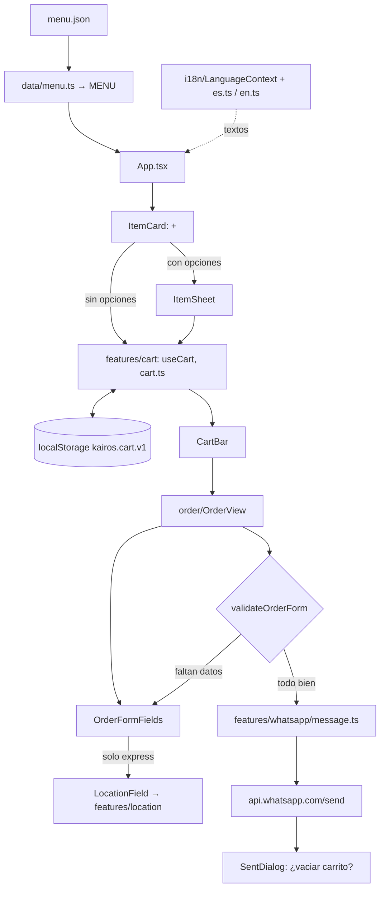

# Guía del código de Kairos (para estudiantes)

Esta guía sirve para leer el código y explicarlo en la exposición. Sale del mapa que armó graphify sobre `src/` (`graphify-out/`, no se sube al repo). Las piezas con más conexiones son `OrderView`, `App`, `MenuSectionView`, `resolveLine` y `formatColones`, y no hay dependencias circulares. El mapa se hizo antes de dividir `OrderView` en `components/order/`.

**La idea en una frase:** `menu.json` → `MENU` → pantallas → carrito → mensaje → WhatsApp. La lógica (precios, validación, mensaje) vive en `src/features/` con pruebas; los componentes solo muestran y avisan cambios.

## El recorrido de un pedido, archivo por archivo

1. **`menu.json`**: el menú impreso transcrito: categorías, platillos, precios, opciones y los textos en inglés (`_en`). Es la única fuente de precios.
2. **`src/data/menu.ts`**: lo convierte en `MENU` (tipos de `features/menu/types.ts`). Arma las notas de sección con el precio del adicional ya formateado, en los dos idiomas.
3. **`src/main.tsx`**: monta `App` dentro de `LanguageProvider` (`src/i18n/LanguageContext.tsx`), que decide el idioma y entrega el diccionario `t`.
4. **`src/App.tsx`**: dibuja `Header`, `SectionNav`, una `MenuSectionView` por sección y el `Footer`. Guarda qué ventana está abierta y el formulario.
5. **`components/ItemCard.tsx`**: el cliente toca **+**. Si el platillo no tiene opciones, `App` lo agrega directo; si tiene, abre **`ItemSheet.tsx`**, donde se escoge tamaño, opción, adicionales, nota y cantidad. El total del botón lo calcula `lineTotal`.
6. **`features/cart/useCart.ts`**: guarda las líneas con `cart.ts` (`addLine` junta las iguales) y las escribe en `localStorage` con `storage.ts` (`kairos.cart.v1`).
7. **`components/CartBar.tsx`**: muestra "3 platillos · ₡7.000". Al tocarla se abre **`components/order/OrderView.tsx`**.
8. **`OrderView`**: muestra cada `OrderLine` (cantidad, quitar, nota), el total y los avisos (`orderWarnings`, `warningText`) y el formulario (`OrderFormFields`). En express sale `LocationField`, que llama a `requestLocation` (`features/location`).
9. **Enviar:** `validateOrderForm` revisa nombre, tipo, pago y, en express, dirección. Si falta algo, devuelve claves de error que la interfaz traduce y el foco va al primer campo marcado.
10. **`features/whatsapp/message.ts`**: `buildOrderMessage` arma el texto, siempre en español, y `buildWhatsAppUrl` lo codifica en `https://api.whatsapp.com/send?phone=…&text=…`. Se abre en una pestaña nueva.
11. **`components/order/SentDialog.tsx`**: pregunta "¿Ya enviaste tu pedido?". Solo si el cliente dice que sí se vacía el carrito.

## Qué hace cada carpeta

| Carpeta | Qué tiene |
|---|---|
| `src/data/` | `menu.ts`: lee `menu.json` y arma `MENU`. |
| `src/features/menu/` | Tipos del menú y precios (`formatColones`, `startingPrice`). |
| `src/features/cart/` | Carrito en funciones puras, guardado en `localStorage` y el hook `useCart`. |
| `src/features/order-form/` | Formulario: tipos, validación, totales y avisos. |
| `src/features/location/` | GPS del celular (`requestLocation`) y enlaces de Google Maps y Waze. |
| `src/features/whatsapp/` | Mensaje del pedido, enlace de WhatsApp y validación del número. |
| `src/i18n/` | Diccionarios `es.ts` y `en.ts`, idioma inicial y guardado, `useLanguage` y textos del menú por idioma. |
| `src/components/` | Interfaz: encabezado, botón de idioma, barra de secciones, tarjetas, ventana del platillo, barra del carrito, pie, íconos y los hooks de las ventanas. |
| `src/components/order/` | Ventana "Tu pedido" dividida en piezas: vista, línea, campos, campo genérico, grupo de radios, ubicación y diálogo. |
| `src/styles/` | `tokens.css` (los únicos colores) y `app.css`. |
| `src/__tests__/`, `*/__tests__/` | Pruebas con Vitest: lógica, componentes y la app completa. |

## Cómo explicar cada parte en 30 segundos

- **`menu.json` y `data/menu.ts`**: "El menú es un JSON. Si sube un precio, se cambia ahí y nada más. `menu.ts` lo pasa a tipos de TypeScript y una prueba revisa que la página muestre exactamente lo del JSON."
- **El carrito (`cart.ts`)**: "Son funciones puras: reciben el carrito y devuelven uno nuevo, sin tocar el original. `resolveLine` cruza cada línea con el menú; si algo no cuadra (un platillo que ya no existe), la línea se ignora, así nunca se cobra un precio inventado."
- **`storage.ts`**: "Guardamos el carrito en `localStorage` para que sobreviva a recargar. Todo va dentro de `try/catch` porque en modo privado leerlo puede fallar, y no confiamos en lo guardado: se revisa línea por línea."
- **Validación**: "`validateOrderForm` no devuelve textos, devuelve claves como `nameMissing`. La interfaz las traduce, así la misma lógica sirve en español y en inglés."
- **Idiomas (`src/i18n/`)**: "Un diccionario por idioma. `en.ts` tiene el tipo de `es.ts`, así que si falta una traducción, TypeScript no compila. `useLanguage()` da el diccionario `t` a cada componente. La elección se guarda en `kairos.lang.v1`."
- **Mensaje de WhatsApp**: "`buildOrderMessage` arma el texto siempre en español, para que la cocina lo lea igual. Si el cliente usó inglés, agrega una línea para avisar. `encodeURIComponent` convierte tildes, ₡ y saltos de línea en `%XX` para que viajen bien en el enlace."
- **Ubicación**: "Es opcional y solo en express. Se pide cuando el cliente toca el botón, con un límite de 10 segundos. Cada error tiene su mensaje. No se guarda: vive en el formulario y viaja en el mensaje como enlace de Maps y de Waze. Solo funciona en HTTPS."
- **Accesibilidad de las ventanas**: "`useDialogFocus` mete el foco en la ventana, lo atrapa con Tab y lo devuelve al cerrar; Escape cierra. `useLockBodyScroll` evita que el menú de atrás se mueva. Las animaciones respetan `prefers-reduced-motion`."
- **Pruebas**: "Más de 170 pruebas con Vitest: la lógica (precios, carrito, mensaje), los componentes y la app completa, desde agregar un platillo hasta abrir WhatsApp, en los dos idiomas."
