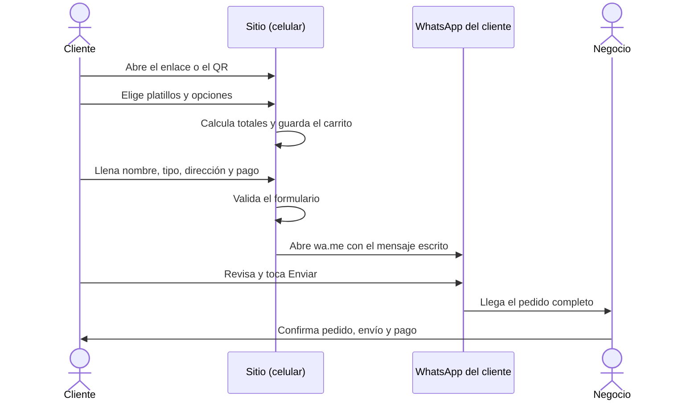
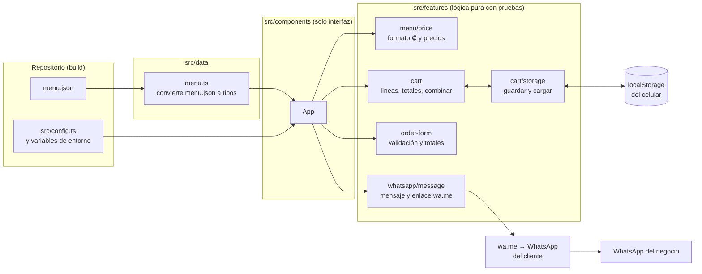
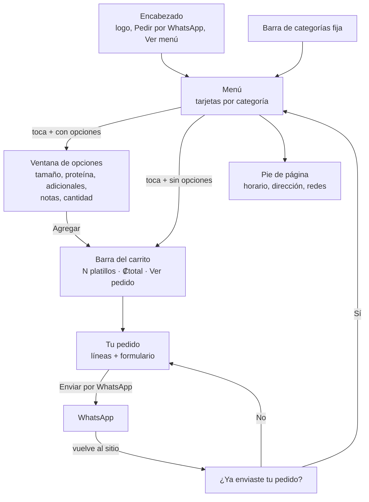

# Semana 2 · Prefactibilidad y planificación

Proyecto de Ingeniería del Software II · Prof. Erick Chaves
Peso: 15 % · Entrega: [PENDIENTE: fecha]
Equipo: [PENDIENTE: nombre del equipo] · Versión del documento: 1 (2026-11-07)

Este documento parte de la propuesta (`01-propuesta.md`). Los códigos A1…A12 son las funcionalidades del alcance de la versión 1 definido allí.

---

## 1. Prefactibilidad técnica

### 1.1 Tecnologías

| Tecnología | Versión en el repo | Para qué | Por qué es factible |
|---|---|---|---|
| Node.js / npm | Node 22 o más reciente (probado con Node 24.15.0 y npm 11.12.1) | Instalar dependencias y correr los comandos | Gratis, multiplataforma (Windows, macOS, Linux). |
| Vite | 8.3.5 | Servidor de desarrollo y build del sitio estático | Arranca en segundos y genera `dist/` listo para publicar. Tiene guía oficial para GitHub Pages. |
| React | 19.3.1 | Interfaz por componentes | Biblioteca muy documentada; el equipo trabaja componente por componente. |
| TypeScript | 7.0.2 | Tipos para el menú, el carrito y el pedido | Detecta errores antes de correr (`npm run typecheck`). |
| Vitest + Testing Library + jsdom | Vitest 5.0.5 | Pruebas unitarias, de integración y de componentes | Usa la misma configuración de Vite; hoy hay 109 pruebas en 12 archivos, todas en verde. |
| GitHub Actions | Workflow `.github/workflows/deploy.yml` | Correr pruebas, tipos y build en cada push y pull request; publicar | Gratis para repos públicos; las actions están fijadas por SHA. |
| GitHub Pages | — | Hosting del sitio estático | Gratis en repos públicos. Límites: sitio publicado de 1 GB y ancho de banda "suave" de 100 GB al mes; el build de `dist/` pesa mucho menos. |
| `@fontsource` (Poppins, Kaushan Script) | 5.3.0 | Fuentes servidas desde el propio sitio | Evita depender de Google Fonts y permite una CSP estricta (ADR 5). |

### 1.2 Infraestructura

- **Sin servidor ni base de datos.** El sitio es HTML, CSS, JS e imágenes estáticos (ADR 1).
- **Datos del menú:** `menu.json` en el repo, leído en el build (ADR 2).
- **Carrito:** `localStorage` del celular del cliente, con la clave `kairos.cart.v1`.
- **Envío del pedido:** un enlace `https://wa.me/<número>?text=<mensaje>` que abre WhatsApp en el celular del cliente.
- **Integración continua y despliegue:** GitHub Actions con dos trabajos. `check` corre pruebas, tipos y build; `deploy` publica solo desde `main` y solo si la variable del repo `PUBLICAR` vale `true` (ADR 4).
- **Costo mensual:** ₡0 mientras el repo sea público y se use GitHub Pages.

### 1.3 Experiencia del equipo

| Integrante | HTML/CSS | JavaScript/TypeScript | React | Pruebas | Git/GitHub |
|---|---|---|---|---|---|
| [PENDIENTE: nombre] | [PENDIENTE: nivel] | [PENDIENTE] | [PENDIENTE] | [PENDIENTE] | [PENDIENTE] |
| [PENDIENTE: nombre] | [PENDIENTE] | [PENDIENTE] | [PENDIENTE] | [PENDIENTE] | [PENDIENTE] |
| [PENDIENTE: nombre] | [PENDIENTE] | [PENDIENTE] | [PENDIENTE] | [PENDIENTE] | [PENDIENTE] |

Escala sugerida: 0 = nunca lo ha usado, 1 = lo ha usado en clase, 2 = lo ha usado en un proyecto, 3 = lo domina.

**Plan para nivelar:** cada integrante hace un recorrido guiado del código (sección 3.3) y escribe o modifica al menos una prueba en la semana 4, para poder explicar cualquier parte en la defensa.

### 1.4 Riesgos de integración

| Riesgo | Mitigación |
|---|---|
| `wa.me` cambia de comportamiento o muestra mal caracteres especiales (ya pasó con los emojis). | Mensaje sin emojis (ADR 3), prueba automática que lo verifica y prueba manual en un celular real antes de publicar. |
| Ruta base distinta en GitHub Pages (`/<repo>/`) rompe enlaces a JS, logo o fuentes. | El workflow pasa `BASE_PATH` desde `actions/configure-pages`; ya se verificó un build con ruta base (`docs/lanzamiento.md`). |
| `localStorage` bloqueado (modo privado) o con datos viejos. | `loadCart` devuelve un carrito vacío ante cualquier error y descarta líneas de platillos que ya no existen (pruebas en `storage.test.ts`). |
| Diferencias de versión de Node entre computadoras del equipo. | Versión mínima documentada (Node 22) y `package-lock.json` en el repo; instalar con `npm ci`. |
| Un cambio en `menu.json` rompe el sitio. | Prueba que compara el sitio contra `menu.json` y valida precios e ids; el workflow no publica si falla. |
| GitHub Pages no publica porque el repo es privado. | Decisión pendiente (sección 3.4): repo público, plan pago u otro hosting. Respaldo para la defensa: `npm run preview` en local. |

**Conclusión técnica:** factible. Todo el stack es gratuito, ya está montado y probado, y no requiere servicios que el equipo deba administrar.

## 2. Prefactibilidad operativa

### 2.1 Usuarios

- **Cliente:** pide desde su celular, para recoger o express. Solo necesita un navegador y WhatsApp.
- **Personal del negocio:** recibe el mensaje en el WhatsApp del negocio y responde para confirmar el pedido, el envío y el pago. No tiene que aprender un sistema nuevo.
- **Equipo de desarrollo:** cambia precios en `menu.json` y publica con un push a `main`.

### 2.2 Proceso de pedido

**Proceso actual del negocio:** [PENDIENTE: resultado de la entrevista. Cómo llegan hoy los pedidos y cuánto tardan en confirmarse.]

### 2.3 Acceso desde el celular

- Diseño mobile-first, probado a 390 px de ancho sin scroll horizontal.
- Sin instalar nada ni crear cuenta.
- Lighthouse móvil (2026-10-22): rendimiento 96, accesibilidad 100, buenas prácticas 100, SEO 100.
- Logo en WebP de 35 KB y fuentes servidas desde el sitio para cargar rápido con datos móviles.

### 2.4 Accesibilidad

- Controles de 44 px o más.
- Las ventanas (opciones del platillo, pedido) mueven el foco adentro y lo devuelven al cerrar.
- Avisos para lector de pantalla al agregar un platillo (`role="status"`).
- Movimiento corto, con alternativa para `prefers-reduced-motion`.
- Colores de la marca con contraste legible: texto blanco y amarillo sobre negro, sin texto sobre el humo.

### 2.5 Condiciones de uso

- El cliente necesita conexión a internet y WhatsApp instalado (o WhatsApp Web en computadora).
- El pedido no queda confirmado al enviarlo: el negocio lo confirma por WhatsApp.
- El pago se acuerda por WhatsApp (efectivo, SINPE Móvil o tarjeta). [PENDIENTE: métodos de pago que acepta el negocio.]
- El costo de envío se confirma por WhatsApp mientras no se conozca la tarifa. [PENDIENTE: zona y costo de envío.]

**Conclusión operativa:** factible, siempre que el negocio acepte confirmar cada pedido a mano por WhatsApp. [PENDIENTE: confirmar en la entrevista.]

## 3. Tiempo y recursos

### 3.1 Tareas

| # | Tarea | Semana | Rol responsable | Depende de |
|---|---|---|---|---|
| T1 | Entrevista con el negocio y resumen | 1–2 | Coordinación | Disponibilidad del negocio |
| T2 | Propuesta y acta (01) | 1 | Todos | — |
| T3 | Prefactibilidad y planificación (02) | 2 | Documentación | T2 |
| T4 | Cada integrante instala y corre el proyecto | 2 | Todos | Manual de instalación |
| T5 | Sacar el número de WhatsApp del código a una variable de entorno | 3 | Repositorio y despliegue | — |
| T6 | Revisar el flujo de punta a punta y completar lo que falte | 3 | Programación | — |
| T7 | Capturas de pantallas, diseño y modelo de datos (03) | 3 | Interfaz | T6 |
| T8 | README, convención de ramas y commits, `.env.example` | 3 | Repositorio y despliegue | T5 |
| T9 | Plan de pruebas, matriz y pruebas nuevas (04) | 4 | Calidad | T6 |
| T10 | Registro y corrección de defectos, regresión | 4 | Programación + Calidad | T9 |
| T11 | Revisión de código | 4 | Todos (en pares) | T10 |
| T12 | Datos pendientes del negocio en `menu.json` y `config.ts` | 2–5 | Coordinación | Respuestas del negocio |
| T13 | Despliegue con número de pruebas (con OK) | 5 | Repositorio y despliegue | T5, decisión del repo |
| T14 | Manual de instalación, informe final, guion de defensa, uso de IA | 5 | Documentación + todos | T13 |
| T15 | Ensayo de la defensa | 5 | Todos | T14 |

### 3.2 Disponibilidad del equipo

| Integrante | Horas por semana | Días y horas disponibles |
|---|---|---|
| [PENDIENTE: nombre] | [PENDIENTE] | [PENDIENTE] |
| [PENDIENTE: nombre] | [PENDIENTE] | [PENDIENTE] |
| [PENDIENTE: nombre] | [PENDIENTE] | [PENDIENTE] |

### 3.3 Herramientas

- Editor: [PENDIENTE: editor que usa el equipo, por ejemplo VS Code].
- Git y GitHub (repositorio `kairos-menu`, pull requests, Actions y Pages).
- Navegador con herramientas de desarrollo (Chrome) y un celular real para probar `wa.me`.
- Herramientas de IA usadas: se documentan en la semana 5.

### 3.4 Dependencias

- **Negocio:** datos pendientes, entrevista y permiso para el número de pruebas y para hacer público el repo.
- **Número de WhatsApp de pruebas:** [PENDIENTE: número de pruebas; no usar el del negocio].
- **Decisión del repo:** público (Pages gratis), plan pago u otro hosting. [PENDIENTE: decisión].
- **Profesor:** acceso al repo. [PENDIENTE: correo institucional del profe].

### 3.5 Plan para que el proyecto corra en 2 o 3 computadoras el día de la defensa

1. **Semana 2:** cada integrante sigue el `README.md` en su computadora (clonar, `npm ci`, `npm test`, `npm run dev`) y anota en una tabla su sistema operativo, versión de Node, si funcionó y qué problema tuvo.
2. **Semana 3:** con esos problemas se corrige el README; el manual de instalación final sale en la semana 5.
3. **Semana 4:** se eligen 3 computadoras para la defensa: [PENDIENTE: integrantes]. En cada una se corre `npm test` y `npm run build`, y se prueba `npm run preview`.
4. **Semana 5, dos días antes de la defensa:** ensayo completo en las 3 computadoras, sin internet de por medio salvo para abrir WhatsApp.
5. **Respaldo:** el sitio publicado en GitHub Pages (si ya hay OK) y una copia de `dist/` en una memoria USB para `npm run preview`.

| Integrante | Sistema operativo | Node | ¿Corre? | Problemas |
|---|---|---|---|---|
| [PENDIENTE] | | | | |
| [PENDIENTE] | | | | |
| [PENDIENTE] | | | | |

## 4. Soluciones similares

| Solución | Qué hace | Costo para el negocio | En qué se diferencia Kairos |
|---|---|---|---|
| **Apps de delivery** (Uber Eats, Rappi y otras) | Catálogo, pedido, pago en línea y repartidor propio de la plataforma. | Comisión por pedido; los restaurantes de Costa Rica han pedido bajarla a la mitad. | Kairos no cobra comisión ni da repartidor; el negocio maneja su propio express y su relación con el cliente. |
| **Biko.cr** (app costarricense) | App de delivery local. | Mensualidad fija (USD 80 al mes según La República) en vez de comisión. | Kairos no tiene mensualidad. |
| **Catálogo y carrito de WhatsApp Business** | El negocio sube productos a su catálogo y el cliente arma un carrito dentro del chat. | Gratis. | No maneja bien tamaños con precio propio, elección de proteína ni adicionales; no pide dirección ni método de pago con validación; el menú hay que cargarlo a mano en la app. |
| **Menús QR genéricos** (Meniu, MENU TIGER y similares) | Menú digital por QR, algunos con pedidos por WhatsApp. | Planes de pago mensuales en la mayoría. | Kairos está hecho a la medida del menú (51 platillos con sus reglas), con la marca propia, sin mensualidad y con el código y los datos del negocio bajo su control. |
| **Foto del menú por WhatsApp o Instagram** (lo que hay hoy) | El cliente lee la imagen y escribe el pedido. | Gratis. | Kairos calcula el total, pide los datos que faltan y deja el mensaje listo. |

**Aporte de Kairos:** un menú digital a la medida, sin costo mensual ni comisión, que envía el pedido completo y con el total calculado por el canal que el negocio ya usa, y que el negocio puede cambiar editando un solo archivo.

[PENDIENTE: el equipo debe abrir cada fuente, confirmar los datos (sobre todo precios y comisiones, que cambian) y anotar la fecha de consulta.]

## 5. Requisitos funcionales priorizados

Prioridad: **I** = imprescindible, **D** = deseable, **O** = opcional.

| ID | Requisito | Prioridad | Alcance (01) | Estado |
|---|---|---|---|---|
| RF-01 | Mostrar el menú completo por categorías, leído de `menu.json`, con precios en formato ₡3.800. | I | A1 | Hecho |
| RF-02 | Navegar entre categorías con una barra fija que marca la sección visible. | D | A2 | Hecho |
| RF-03 | Elegir tamaño, proteína, adicionales, notas y cantidad de un platillo, con el precio calculado. | I | A3 | Hecho |
| RF-04 | Agregar platillos sin opciones con un solo toque. | D | A3 | Hecho |
| RF-05 | Calcular el total del carrito y combinar líneas iguales. | I | A4 | Hecho |
| RF-06 | Guardar el carrito en el celular y descartar líneas inválidas al cargarlo. | D | A4 | Hecho |
| RF-07 | Cambiar cantidades, quitar platillos y editar notas en "Tu pedido". | I | A5 | Hecho |
| RF-08 | Validar el formulario: nombre, tipo, método de pago y dirección si es express. | I | A6 | Hecho |
| RF-09 | Armar el mensaje del pedido y abrir WhatsApp con el texto listo. | I | A7 | Hecho |
| RF-10 | Marcar precios y costos por confirmar en la tarjeta, la barra del carrito y el mensaje. | I | A8 | Hecho |
| RF-11 | Preguntar "¿Ya enviaste tu pedido?" al volver, sin vaciar el carrito solo. | D | A9 | Hecho |
| RF-12 | Desactivar el envío si no hay número de WhatsApp configurado. | I | A7 | Hecho |
| RF-13 | Tomar el número de WhatsApp de una variable de entorno, para usar uno de pruebas en la demo. | I | A12 | Por hacer (semana 3) |
| RF-14 | Mostrar horario, dirección y redes en el pie de página cuando estén definidos. | O | — | Hecho (sin datos aún) |
| RF-15 | Sumar el costo de envío al total cuando esté definido. | O | — | Hecho (sin dato aún) |

**Requisitos no funcionales**

| ID | Requisito | Prioridad |
|---|---|---|
| RNF-01 | Funciona en un celular de 360–390 px de ancho sin scroll horizontal. | I |
| RNF-02 | Controles de 44 px o más, foco manejado en ventanas y textos con contraste legible. | I |
| RNF-03 | Lighthouse móvil de 90 o más en rendimiento y accesibilidad. | D |
| RNF-04 | Ningún precio fuera de `menu.json`; ningún dato del negocio inventado. | I |
| RNF-05 | Sin recursos de terceros; CSP que solo permite el propio sitio. | D |
| RNF-06 | No se publica si fallan pruebas, tipos o build. | I |

## 6. Historias de usuario

**HU-01 · Ver el menú** (RF-01, RF-02)
Como cliente, quiero ver el menú ordenado por categorías en mi celular, para encontrar rápido lo que se me antoja.
- Dado que abro el sitio, entonces veo las 11 categorías y los 51 platillos con nombre, descripción (si tiene) y precio con formato ₡3.800.
- Dado un platillo con tamaños, entonces su precio dice "desde" el precio más bajo.
- Dado que toco una categoría en la barra, entonces la página baja hasta esa sección y la categoría queda marcada.
- Dado un platillo con `por_confirmar` en `menu.json`, entonces se muestra "Precio por confirmar".

**HU-02 · Armar un platillo** (RF-03, RF-04)
Como cliente, quiero elegir tamaño, proteína y adicionales, para que el pedido salga como lo quiero.
- Dado un platillo con opciones, cuando toco **+**, entonces se abre una ventana con tamaño, proteína, adicionales, notas y cantidad.
- Dado que elijo tamaño Grande y marco "Papas fritas", entonces el botón muestra (precio Grande + ₡1.200) × cantidad.
- Dado un platillo sin opciones, cuando toco **+**, entonces se agrega directo con cantidad 1 y se anuncia "Agregado: <nombre>".
- Dado un platillo con elección de proteína, entonces la primera opción viene marcada, así que el platillo nunca se agrega sin proteína, y la elegida aparece en el carrito y en el mensaje.

**HU-03 · Revisar el carrito** (RF-05, RF-06, RF-07)
Como cliente, quiero ver cuánto llevo y corregir mi pedido, para no equivocarme antes de enviarlo.
- Dado que agrego un platillo, entonces aparece una barra con "N platillos · ₡total · Ver pedido".
- Dado que agrego dos veces el mismo platillo con las mismas opciones, entonces queda una sola línea con cantidad 2.
- Dado que cambio la cantidad o quito una línea, entonces el total se recalcula.
- Dado que cierro y vuelvo a abrir el sitio en el mismo celular, entonces el carrito sigue ahí.
- Dado un carrito guardado con un platillo que ya no existe en el menú, entonces esa línea se descarta y las demás se conservan.

**HU-04 · Enviar el pedido** (RF-08, RF-09, RF-12)
Como cliente, quiero mandar el pedido ya escrito por WhatsApp, para no tener que redactarlo.
- Dado que falta el nombre, el tipo o el método de pago, cuando toco "Enviar por WhatsApp", entonces veo un mensaje debajo de cada campo que falta y no se abre WhatsApp.
- Dado que elijo express sin dirección, entonces veo "Falta la dirección".
- Dado un formulario válido, cuando toco "Enviar por WhatsApp", entonces se abre `wa.me` con un mensaje que trae cada platillo, sus opciones, sus adicionales, el total, el nombre, el tipo, la dirección (si es express) y el método de pago.
- Dado que el total del mensaje se compara con el del carrito, entonces son iguales.
- Dado que no hay número configurado, entonces el botón dice "Número pendiente" y está desactivado.

**HU-05 · Saber qué falta confirmar** (RF-10, RF-15)
Como negocio, quiero que el pedido diga qué precios están por confirmar, para no comprometerme con un precio que no he aprobado.
- Dado un pedido express sin costo de envío configurado, entonces el mensaje termina con "Costo de envío por confirmar".
- Dado un desayuno con nota (adicionales sin precio), entonces el mensaje dice que los adicionales están por confirmar.
- Dado un platillo con precio por confirmar, entonces la barra del carrito muestra el total como aproximado y el mensaje lo avisa.
- Dado un costo de envío configurado, entonces aparece una línea "Envío" y se suma al total.

**HU-06 · No perder el pedido** (RF-11)
Como cliente, quiero decidir cuándo se vacía mi carrito, para no perderlo si WhatsApp no se abrió.
- Dado que envié el pedido y vuelvo al sitio, entonces se me pregunta "¿Ya enviaste tu pedido?".
- Cuando elijo "Sí, vaciar carrito", entonces el carrito queda vacío.
- Cuando elijo "No, volver al pedido", entonces el carrito se conserva.

**HU-07 · Cambiar un precio** (RNF-04, RNF-06)
Como equipo de desarrollo, quiero cambiar un precio en un solo archivo, para no dejar precios distintos en el sitio.
- Dado que cambio un precio en `menu.json`, entonces el sitio muestra el nuevo precio sin tocar otro archivo.
- Dado que dejo un platillo sin precio ni tamaños, o con un `id` repetido, entonces `npm test` falla y el workflow no publica.

**HU-08 · Probar sin molestar al negocio** (RF-13)
Como integrante del equipo, quiero que la demo use un número de WhatsApp de pruebas, para que los compañeros puedan pedir sin escribirle al negocio.
- Dado que defino el número en una variable de entorno, entonces el sitio lo usa al armar el enlace de WhatsApp.
- Dado que no defino la variable, entonces el botón dice "Número pendiente".
- Dado el repo, entonces el número real del negocio no aparece en el código, en las pruebas, en los ejemplos ni en las capturas.

## 7. Arquitectura inicial

### 7.1 Componentes y flujo de datos

Regla de diseño: los componentes no calculan precios ni arman el texto del pedido; todo eso está en `src/features/*` y tiene pruebas.

### 7.2 Pantallas

La aplicación es una sola página con vistas que se superponen.

Componentes en el código: `Header`, `SectionNav`, `MenuSectionView` + `ItemCard`, `ItemSheet`, `CartBar`, `OrderView` (incluye la pregunta de envío) y `Footer`.

## 8. Datos sensibles y cómo se protegen

| Dato | Dónde vive | Riesgo | Protección |
|---|---|---|---|
| Número de WhatsApp del negocio | Hoy en `src/config.ts` y en el historial de git | Si el repo se hace público, queda expuesto; los compañeros que prueben la demo le escribirían al negocio. | Moverlo a una variable de entorno (`.env`, excluido por `.gitignore`), usar un número de pruebas en la demo (semana 3) y decidir qué hacer con el historial antes de hacer público el repo. No aparece en ejemplos, pruebas ni capturas. |
| Nombre, dirección y comentario del cliente | Solo en la memoria de la página mientras se llena el formulario; no se guardan en `localStorage` | Que se filtren o se guarden sin permiso. | No hay servidor, base de datos ni analítica: el sitio nunca recibe estos datos. Viajan solo en el mensaje que el cliente envía desde su propio WhatsApp. |
| Notas del carrito | `localStorage` del celular del cliente | Otra persona con el mismo celular puede verlas. | Solo contienen lo que el cliente escribe sobre su pedido; el cliente puede vaciar el carrito. Se recomienda no escribir datos personales en las notas. |
| Datos de prueba | Pruebas automáticas y capturas | Usar datos reales de personas. | Solo datos sintéticos (por ejemplo "Ana", "Barrio X") y números de ejemplo. |
| Secretos (tokens, contraseñas) | No hay | — | El despliegue usa el token temporal de GitHub Actions; ningún secreto va en el repo. |

Además: la CSP solo permite recursos del propio sitio (ADR 5), los enlaces externos usan `noopener` y el sitio se sirve por HTTPS en GitHub Pages.

Marco legal de referencia: Ley N.° 8968 de Protección de la Persona frente al Tratamiento de sus Datos Personales (Costa Rica). Como el sitio no recolecta ni almacena datos personales en un servidor, no forma una base de datos de clientes. [PENDIENTE: el equipo debe confirmar esta lectura con la ley o con el profesor.]

## 9. Cronograma y control de cambios

### 9.1 Cronograma de 5 semanas

| Semana | Entrega | Tareas | Responsable (rol) | Integrante |
|---|---|---|---|---|
| 1 | Lunes 9 nov 2026 | T1, T2 | Coordinación / todos | [PENDIENTE] |
| 2 | [PENDIENTE: fecha] | T1, T3, T4, T12 | Documentación / todos | [PENDIENTE] |
| 3 | [PENDIENTE: fecha] | T5, T6, T7, T8, T12 | Repositorio, Programación, Interfaz | [PENDIENTE] |
| 4 | [PENDIENTE: fecha] | T9, T10, T11, T12 | Calidad, Programación, todos | [PENDIENTE] |
| 5 | [PENDIENTE: fecha] | T13, T14, T15 | Repositorio, Documentación, todos | [PENDIENTE] |

### 9.2 Estrategia de control de cambios

1. **Línea base:** el alcance de la versión 1 de `01-propuesta.md` (A1–A12) y los requisitos de este documento.
2. **Solicitud:** cualquier cambio de alcance (agregar, quitar o modificar un requisito) se abre como un *issue* en GitHub con la etiqueta `cambio-de-alcance`, explicando qué cambia, por qué y qué afecta (tiempo, pruebas, documentos).
3. **Evaluación:** el equipo lo revisa en la reunión semanal. Si toca datos del negocio (precios, platillos, número), también se necesita el OK del negocio.
4. **Aprobación:** se aprueba con la mayoría del equipo y se anota en la tabla de abajo. Si es una decisión técnica, se escribe un ADR en `docs/adr/`.
5. **Implementación:** en una rama propia, con pull request revisado por otro integrante, y con `npm test`, `npm run typecheck` y `npm run build` en verde (el workflow lo exige).
6. **Registro:** el cambio queda en el issue, en el pull request y en la tabla de cambios.

| Fecha | Cambio | Motivo | Aprobado por | Issue / PR |
|---|---|---|---|---|
| 2026-10-22 | El menú vive en `menu.json` y no en `menu.ts` | Reglas del cliente: un solo lugar para los precios | Equipo de desarrollo (ADR 2) | — |
| 2026-10-22 | Mensaje de WhatsApp sin emojis | `wa.me` los mostraba como "�" | Negocio (ADR 3) | — |
| 2026-10-22 | GitHub Pages en vez de Netlify o Cloudflare Pages | Gratis y sin cuentas fuera de GitHub | Propuesta (ADR 4) | — |
| [PENDIENTE] | Número de WhatsApp en variable de entorno y número de pruebas para la demo | Proteger el número real y no molestar al negocio | [PENDIENTE] | [PENDIENTE] |

## 10. Fuentes consultadas y decisiones técnicas iniciales

### 10.1 Decisiones técnicas (ADR del repo)

- [ADR 1: Sitio estático con pedidos por WhatsApp](../adr/0001-sitio-estatico-con-pedidos-por-whatsapp.md)
- [ADR 2: `menu.json` es la única fuente del menú](../adr/0002-menu-json-unica-fuente.md)
- [ADR 3: Precios con punto de miles, ortografía del menú impreso y mensaje sin emojis](../adr/0003-precios-y-ortografia.md)
- [ADR 4: Publicar en GitHub Pages con GitHub Actions](../adr/0004-github-pages-con-actions.md) (propuesta)
- [ADR 5: Todo servido desde el propio sitio, con CSP](../adr/0005-seguridad-y-rendimiento.md)
- Especificación aprobada: [`docs/superpowers/specs/2026-10-22-menu-digital-design.md`](../superpowers/specs/2026-10-22-menu-digital-design.md)
- Plan de implementación: [`docs/superpowers/plans/2026-10-22-menu-digital.md`](../superpowers/plans/2026-10-22-menu-digital.md)

### 10.2 Fuentes

| Tema | Fuente |
|---|---|
| Despliegue de Vite en GitHub Pages | Vite, *Deploying a Static Site*. https://vite.dev/guide/static-deploy#github-pages |
| Límites de GitHub Pages | GitHub Docs, *GitHub Pages limits*. https://docs.github.com/en/pages/getting-started-with-github-pages/github-pages-limits |
| Uso de WhatsApp en Costa Rica | CICOM-UCR, *Nuestras apps de cada día 2025*. https://cicom.ucr.ac.cr/cicom_informe_apps-2025/ |
| Comisiones de apps de delivery | El Observador CR. https://observador.cr/noticia/restaurantes-piden-a-empresas-repartidoras-que-bajen-a-la-mitad-las-tarifas-de-comision/ |
| Apps de entrega y restaurantes | El Financiero CR. https://www.elfinancierocr.com/negocios/ef-explica-apps-de-entrega-y-restaurantes/TMWJMJSIFNHGVN57PUDDZ5EVFY/story/ |
| Biko.cr, mensualidad en vez de comisión | La República. https://www.larepublica.net/noticia/la-costarricense-bikocr-competira-con-uber-eats-glovo-y-rappi |
| Carrito de WhatsApp Business | Meta, anuncio de carritos en WhatsApp (dic. 2020). https://about.fb.com/es/news/2020/12/facilitamos-la-experiencia-de-compra-en-whatsapp-con-la-implementacion-de-carritos/ |
| Menús QR con pedidos por WhatsApp | Meniu. https://meniuapp.com/en · MENU TIGER. https://www.qrcode-tiger.com/es/menu-app |
| Protección de datos personales | Ley N.° 8968, Costa Rica. [PENDIENTE: enlace a SCIJ o PRODHAB, verificado por el equipo] |

[PENDIENTE: fecha de consulta de cada fuente, confirmada por el equipo al abrirla.]
