# Semana 3 · Diseño y desarrollo (MVP)

Proyecto de Ingeniería del Software II · Prof. Erick Chaves
Peso: [PENDIENTE: peso] · Entrega: [PENDIENTE: fecha]
Equipo: [PENDIENTE: nombre del equipo] · Versión del documento: 1 (2026-11-07)

Requisitos (RF/RNF) e historias de usuario (HU) de referencia: `02-prefactibilidad.md`.

---

## 1. Estado del MVP

El flujo de punta a punta está completo y verificado: **ver menú → elegir platillo y adicionales → carrito → enviar el pedido por WhatsApp**.

Verificación del 2026-11-07, en Chrome emulando un celular de 390 × 844 px, sobre el build de producción con un número ficticio (`50600000000`) y con `window.open` interceptado para no abrir WhatsApp:

| Paso | Resultado |
|---|---|
| Abrir el sitio | Carga sin errores de consola y sin scroll horizontal. |
| Agregar Bacon & Chesse con pechuga de pollo y papas fritas | La ventana muestra "Agregar · ₡5.000" (₡3.800 + ₡1.200). |
| Agregar 2 Taco sencillo (carne) | La barra muestra 3 platillos y ₡7.000. |
| Enviar con el formulario vacío | No se abre WhatsApp; aparecen "Falta el nombre", "Falta el tipo de pedido" y "Falta el método de pago". |
| Elegir express sin dirección | Aparece "Falta la dirección" y no se envía. |
| Formulario completo | Se abre `https://wa.me/50600000000?text=…` (desde la semana 4, `https://api.whatsapp.com/send?phone=50600000000&text=…`, ver D-01) y aparece "¿Ya enviaste tu pedido?". |
| Carrito guardado | `localStorage` (`kairos.cart.v1`) tiene las dos líneas con sus opciones. |

Mensaje generado (datos sintéticos):

```
¡Hola Kairos Food's! Quiero hacer un pedido

1× Bacon & Chesse (Pechuga de pollo) — ₡3.800
   + Papas fritas — ₡1.200
2× Taco sencillo (Carne) — ₡2.000

Total: ₡7.000

Nombre: Ana
Tipo: Express
Dirección: Barrio X, 200 m sur de la iglesia
Pago: SINPE Móvil

Costo de envío por confirmar
```

**Lo que faltaba y se completó en esta semana:** RF-13 / HU-08, que el número de WhatsApp salga de una variable de entorno y no del código (sección 7 y ADR 6). El resto del flujo ya estaba hecho.

## 2. Flujo principal

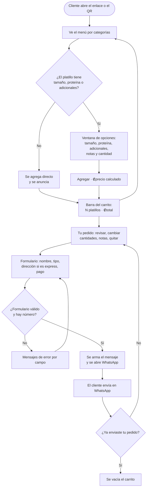

## 3. Prototipos de pantallas

Capturas reales del sitio a 390 × 844 px (densidad 2×), con datos sintéticos. Están en `docs/proyecto-final/capturas/`.

| | |
|---|---|
| **1. Inicio** — logo, frase, "Ver menú" y "Pedir por WhatsApp"; barra de categorías. <br>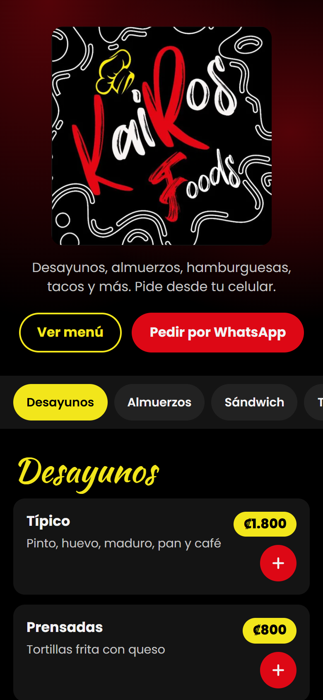 | **2. Sección del menú** — tarjetas con nombre, descripción, precio en óvalo amarillo y botón +. <br>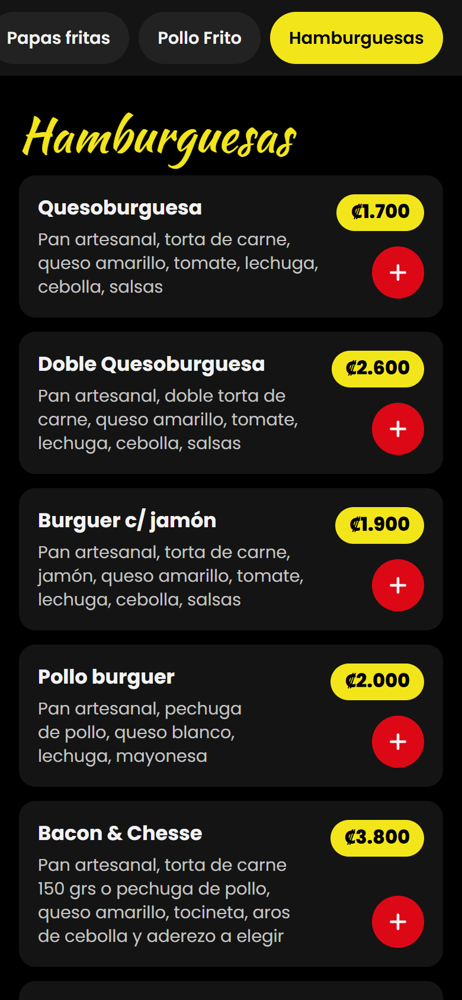 |
| **3. Ventana de opciones** — proteína, adicionales con precio, notas, cantidad y precio calculado. <br>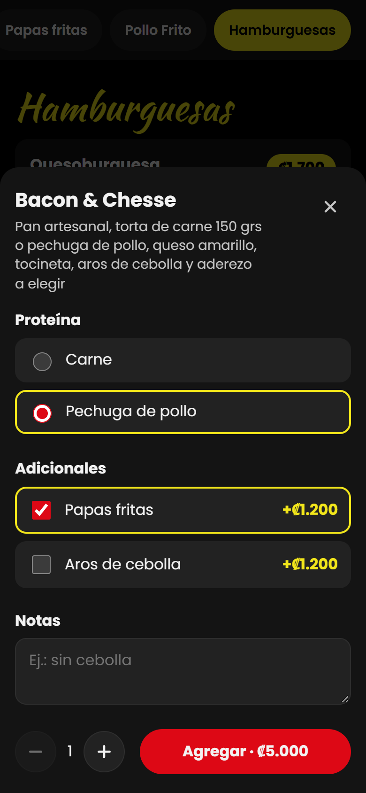 | **4. Barra del carrito** — cantidad de platillos, total y "Ver pedido". <br>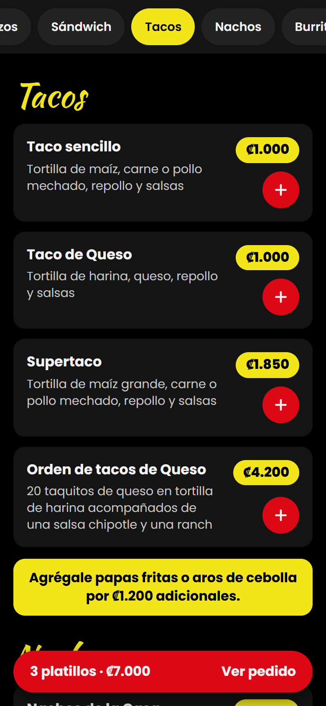 |
| **5. Tu pedido** — líneas con cantidad, quitar y nota; total. <br>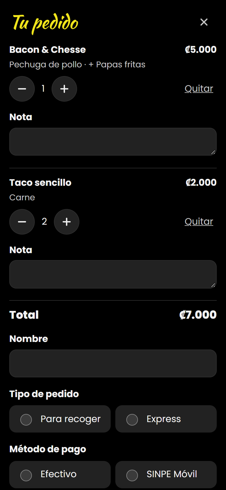 | **6. Errores del formulario** — mensaje debajo de cada campo que falta. <br>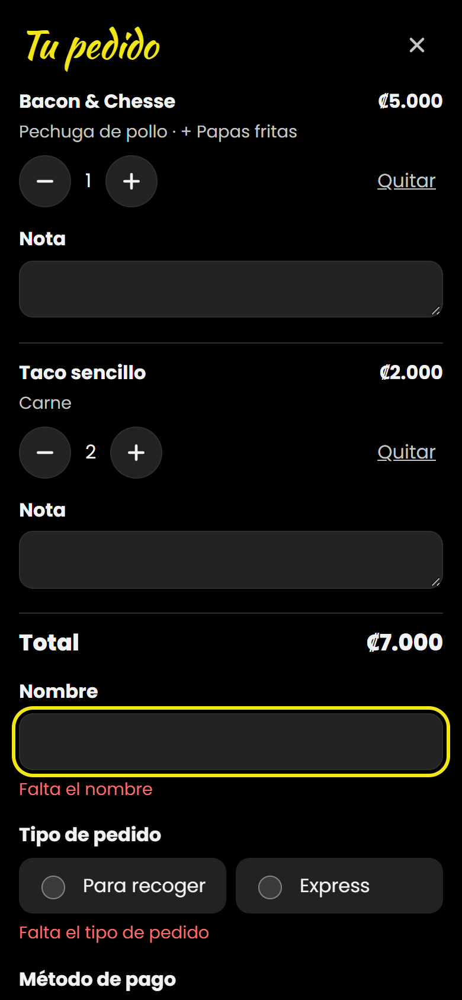 |
| **7. Formulario lleno** — express, dirección, SINPE Móvil y aviso de envío por confirmar. <br>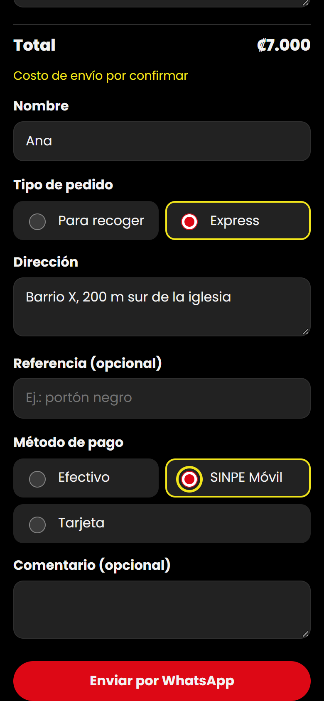 | **8. Después de enviar** — "¿Ya enviaste tu pedido?" sin vaciar el carrito solo. <br>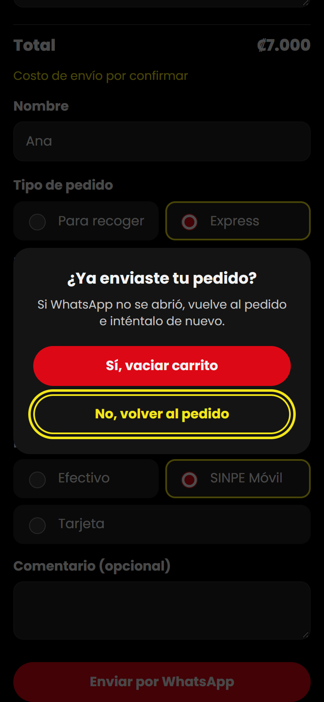 |

Identidad visual: negro de fondo, rojo #DD0815 en botones, amarillo #F2E61B en títulos, óvalos de precio y foco; Kaushan Script para títulos de sección y Poppins para el resto. Los colores salen de variables en `src/styles/tokens.css`.

## 4. Diseño de componentes

### 4.1 Capas

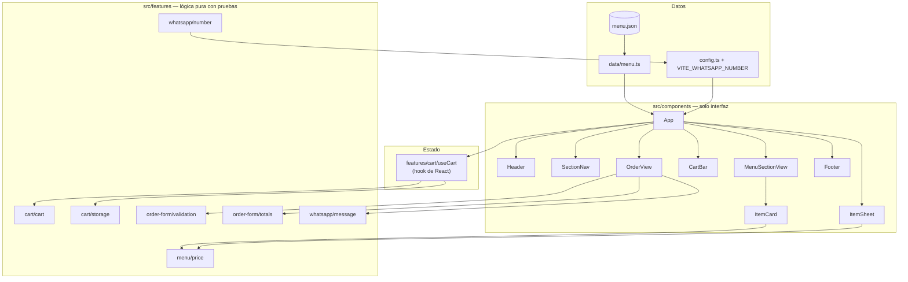

Regla: los componentes no calculan precios ni arman el texto del pedido. Si una pantalla necesita un número, lo pide a `src/features/*`.

### 4.2 Responsabilidades

| Componente | Responsabilidad | Recibe |
|---|---|---|
| `App` | Une todo: menú, carrito, platillo seleccionado, pedido abierto, formulario y avisos para lector de pantalla. | — |
| `Header` | Logo, frase, "Ver menú" y "Pedir por WhatsApp". | `whatsappNumber` |
| `SectionNav` | Barra fija de categorías; marca la visible y baja a la elegida. | `sections` |
| `MenuSectionView` / `ItemCard` | Título y nota de la sección; tarjeta con nombre, descripción, precio y botón +. | `section`, `onAdd` |
| `ItemSheet` | Ventana de opciones: tamaño, elección, adicionales, notas, cantidad y precio calculado. | `menu`, `item`, `onAdd`, `onClose` |
| `CartBar` | Barra fija con cantidad, total (o "aprox.") y "Ver pedido". | `count`, `total`, `hasPending`, `onOpen` |
| `OrderView` | Líneas del carrito, formulario, validación, envío y diálogo "¿Ya enviaste tu pedido?". | `menu`, `lines`, `form`, `whatsappNumber`, `deliveryFee` y callbacks |
| `Footer` | Horario, dirección y redes, solo si están definidos. | `config` |
| `useDialogFocus`, `useLockBodyScroll` | Foco dentro de las ventanas y bloqueo del scroll de fondo. | — |

## 5. Interfaces (funciones públicas de la lógica)

| Módulo | Función | Qué hace |
|---|---|---|
| `menu/price` | `formatColones(monto)` | `3800` → `"₡3.800"`. |
| | `displayPrice(item)` | Precio de la tarjeta; `"desde ₡X"` si tiene tamaños. |
| | `hasOptions(item)` | Si el + abre la ventana de opciones. |
| `cart/cart` | `resolveLine(menu, línea)` | Busca platillo, tamaño y adicionales; `null` si algo ya no existe. |
| | `lineTotal(menu, línea)` | (precio base o tamaño + adicionales) × cantidad. |
| | `addLine`, `setQuantity`, `setNote`, `removeLine`, `mergeLines` | Cambios inmutables del carrito; las líneas iguales se combinan. |
| | `cartTotal`, `itemCount`, `needsPriceConfirmation` | Totales y aviso de adicionales por confirmar. |
| `cart/storage` | `loadCart(store, menu)`, `saveCart(store, líneas)` | Lee y guarda en `localStorage`; descarta lo inválido. |
| `order-form/validation` | `validateOrderForm(form)`, `hasErrors(errores)` | Errores por campo ("Falta el nombre"…). |
| `order-form/totals` | `deliveryFeeFor`, `orderTotal`, `orderWarnings` | Envío, total final y avisos por confirmar. |
| `whatsapp/message` | `buildOrderMessage(menu, líneas, form, envío)` | Texto del pedido. |
| | `buildWhatsAppUrl(teléfono, mensaje)` | `https://api.whatsapp.com/send?phone=<dígitos>&text=<mensaje codificado>` (D-01). |
| `whatsapp/number` | `parseWhatsappNumber(valor)` | Valida y limpia el número de la variable de entorno. |
| `location/location` | `requestLocation(geo?)` | Pide el GPS; devuelve `{ lat, lng }` o falla con `'denied'`, `'unavailable'` o `'unsupported'`. |
| | `mapsLink(punto)` | `https://www.google.com/maps?q=<lat>,<lng>` con 6 decimales. |

Interfaces externas: `api.whatsapp.com/send` (se abre como navegación, no como petición), `localStorage` y la geolocalización del navegador (solo si el cliente la pide; funciona en HTTPS o `localhost`). No hay API propia ni servidor.

## 6. Modelo de datos

### 6.1 `menu.json` (fuente única del menú)

```jsonc
{
  "negocio": "Kairos Foods",
  "moneda": "...",
  "categorias": [
    {
      "id": "hamburguesas",              // estable
      "nombre": "Hamburguesas",
      "nota": "Agrégale papas fritas o aros de cebolla por {precio} adicionales",
      "adicionales": [                   // extras con precio para toda la sección
        { "id": "papas", "nombre": "Papas fritas", "precio": 1200 },
        { "id": "aros", "nombre": "Aros de cebolla", "precio": 1200 }
      ],
      "items": [
        {
          "id": "bacon-cheese",          // estable: lo usa el carrito guardado
          "nombre": "Bacon & Chesse",    // ortografía del menú impreso
          "descripcion": "Pan artesanal, torta de carne 150 grs o pechuga de pollo, ...",
          "precio": 3800,                // colones enteros
          "elegir": { "etiqueta": "Proteína", "opciones": ["Carne", "Pechuga de pollo"] }
        }
      ]
    },
    {
      "id": "papas", "nombre": "Papas fritas",
      "items": [
        {
          "id": "papas-fritas", "nombre": "Papas Fritas", "descripcion": "",
          "opciones": [                  // tamaños: reemplazan a "precio"
            { "id": "regular", "nombre": "Regulares", "precio": 1000 },
            { "id": "grande", "nombre": "Grandes", "precio": 2700 }
          ],
          "por_confirmar": "Las grandes cuestan ₡2.700 contra ₡1.000 ..."
        }
      ]
    }
  ],
  "pendiente_confirmar_con_el_negocio": ["..."],
  "notas_estructura": ["..."]
}
```

Reglas (verificadas por pruebas): cada platillo tiene `precio` u `opciones`, nunca los dos ni ninguno; precios enteros positivos; `id` sin repetir. `adicionales_sin_precio: true` (desayunos) marca adicionales que se piden en notas.

`src/data/menu.ts` lo convierte a los tipos del sitio:

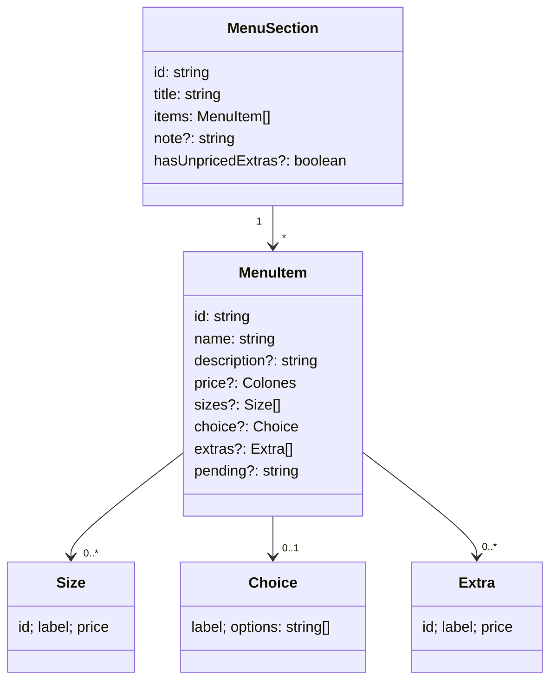

### 6.2 Estructura del pedido

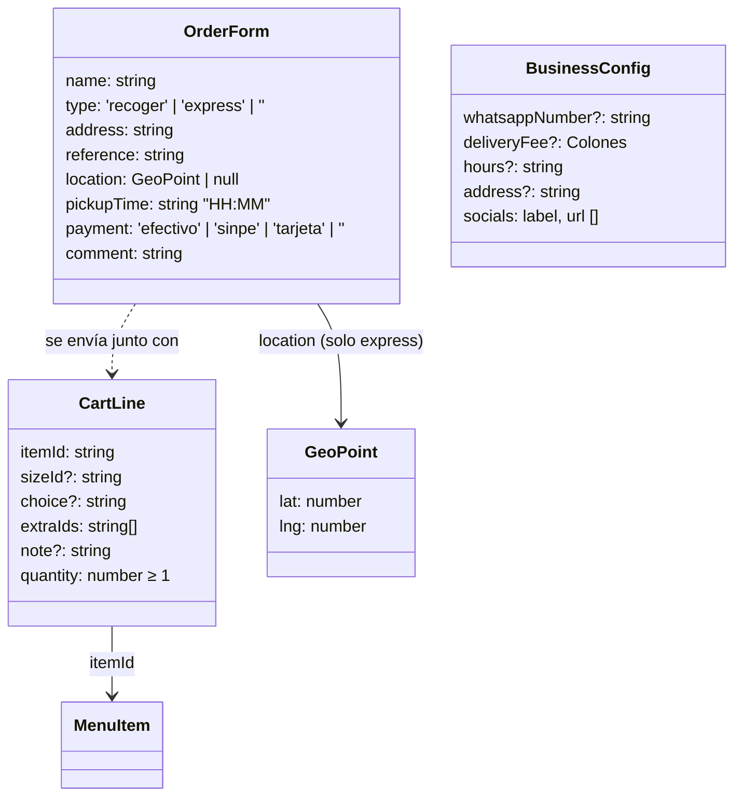

- **Carrito:** arreglo de `CartLine` guardado en `localStorage` con la clave `kairos.cart.v1`. Solo guarda ids y lo que eligió el cliente; los precios se recalculan siempre desde `menu.json`.
- **Formulario:** vive solo en la memoria de la página; **no** se guarda. Incluye la ubicación, si el cliente la compartió.
- **Pedido enviado:** no existe como dato en el sitio; es el texto del mensaje que el cliente manda por WhatsApp.

## 7. Cambios en el repositorio esta semana

| Cambio | Archivos |
|---|---|
| El número de WhatsApp sale de `VITE_WHATSAPP_NUMBER` y no del código (RF-13, HU-08). Prueba escrita primero (TDD): 7 casos. | `src/features/whatsapp/number.ts`, `src/features/whatsapp/__tests__/number.test.ts`, `src/config.ts`, `src/vite-env.d.ts` |
| El workflow pasa la variable del repo `WHATSAPP_NUMBER` al build de publicación. | `.github/workflows/deploy.yml` |
| `.env.example` sin valores reales; `.gitignore` excluye `.env`, `.env.*`, `*.pem` y `*.key`. | `.env.example`, `.gitignore` |
| README con instalación paso a paso, estructura de carpetas, convenciones de ramas, commits y revisión, y cómo agregar al profesor. | `README.md` |
| ADR 6. | `docs/adr/0006-numero-de-whatsapp-por-variable-de-entorno.md` |

Verificación después de los cambios: `npm test` 116 pruebas en 13 archivos, todas pasan; `npm run typecheck` sin errores; `npm run build` correcto; el número real ya no aparece en el código ni en `dist/`.

## 8. Registro

### 8.1 Tareas terminadas

| Fecha | Tarea | Responsable | Evidencia |
|---|---|---|---|
| 2026-10-22 | Spec, plan y MVP completo (menú, carrito, formulario, mensaje, accesibilidad, CSP, workflow) | [PENDIENTE: integrante(s)] | Commits `d6fdf4e` a `b638bb2`; `docs/lanzamiento.md` |
| 2026-10-24 | Número de WhatsApp del negocio confirmado | [PENDIENTE] | Commit `1840854` |
| 2026-11-07 | Propuesta (01) y prefactibilidad (02) | [PENDIENTE] | `docs/proyecto-final/` |
| 2026-11-07 | T5: número por variable de entorno | [PENDIENTE] | Sección 7, ADR 6 |
| 2026-11-07 | T6: verificación del flujo de punta a punta | [PENDIENTE] | Sección 1 |
| 2026-11-07 | T7, T8: diseño, capturas, README y `.env.example` | [PENDIENTE] | Este documento, `README.md` |

### 8.2 Decisiones técnicas

| ADR | Decisión | Estado |
|---|---|---|
| 1 | Sitio estático con pedidos por WhatsApp | Aceptada |
| 2 | `menu.json` es la única fuente del menú | Aceptada |
| 3 | Precios ₡3.800, ortografía del menú impreso, mensaje sin emojis | Aceptada |
| 4 | GitHub Pages con GitHub Actions | Propuesta |
| 5 | Todo servido desde el propio sitio, con CSP | Aceptada |
| 6 | Número de WhatsApp por variable de entorno | Propuesta |
| 7 | Español e inglés con diccionario propio | Aceptada (nueva) |
| 8 | Ubicación opcional sin guardarla, con Maps y Waze | Aceptada (nueva) |

### 8.3 Cambios de alcance

| Fecha | Cambio | Estado |
|---|---|---|
| 2026-11-07 | Agregar RF-13 (número por variable de entorno y número de pruebas para la demo) | Implementado; [PENDIENTE: aprobación del equipo según el control de cambios de `02-prefactibilidad.md`] |
| 2026-11-18 | Agregar A13 / RF-16 / HU-09 (ubicación opcional por GPS en express) | Implementado en `d4f9aac` con pruebas; [PENDIENTE: aprobación del equipo y del negocio] |
| 2026-11-22 | Agregar A14: español e inglés (ADR 7). Ubicación con Waze, error de tiempo agotado y aviso sin HTTPS (ADR 8) | Implementado en la rama `semana-3` con pruebas; aprobado por Jose el 2026-11-22 |

No hubo otros cambios de alcance respecto a `01-propuesta.md`.
